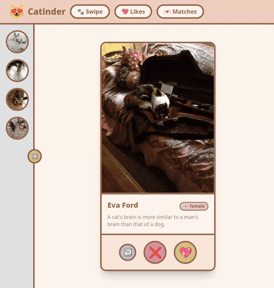

# Catinder


Catinder is a Tinder-style web app for cats. Swipe through cat profiles, like the ones you fancy and wait to see who likes you back. Every match gets its own chat, where the cat answers through an LLM playing a slightly arrogant, always hungry cat that works "meow" into its replies. Likes, matches and conversations are saved in the browser, so they survive a refresh.



## Tech stack

- Angular 22
- TypeScript
- RxJS
- Tailwind CSS 4
- Vitest
- Web Audio API
- .NET 10 minimal API
- Groq API
- Docker Compose
- TheCatAPI
- RandomUser
- MeowFacts

## Getting started

### Requirements

- Node.js 22.22.3 or newer
- .NET 10 SDK
- A free Groq API key from [console.groq.com](https://console.groq.com/), needed for the chat only

### Clone

```bash
git clone https://github.com/Zambrzyckii/catinder.git
cd catinder
```

### Backend

```bash
cd backend/Api
echo "API_KEY=your_groq_api_key" > .env
dotnet run
```

### Frontend

In a second terminal, from the repository root.

```bash
cd frontend
npm install
npm start
```

Open http://localhost:4200. The frontend expects the API at http://localhost:5285, which is where `dotnet run` serves it.
